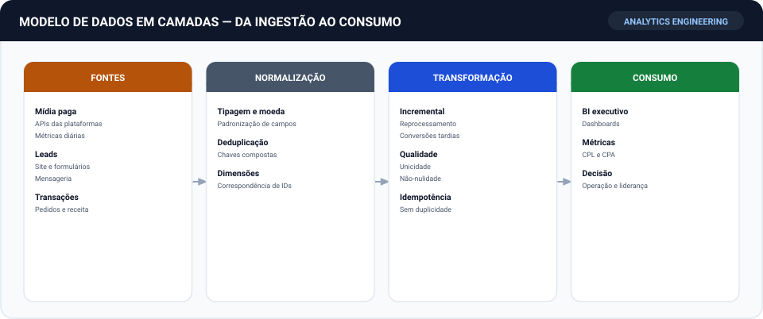
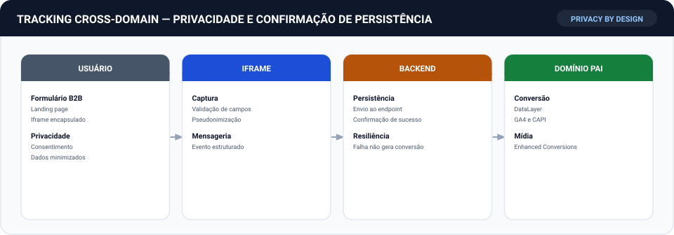
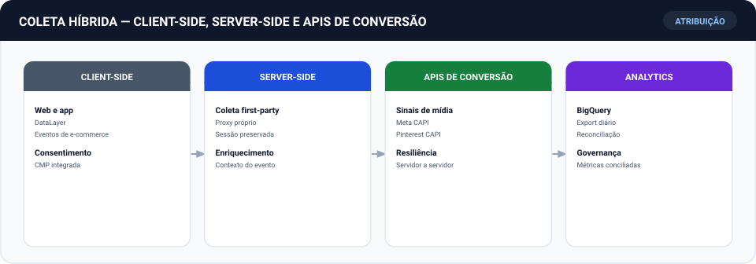
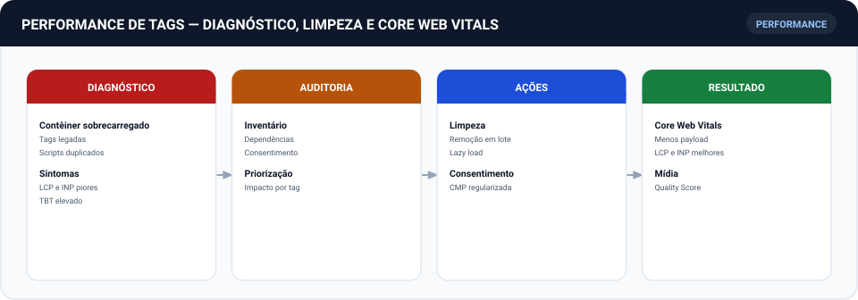
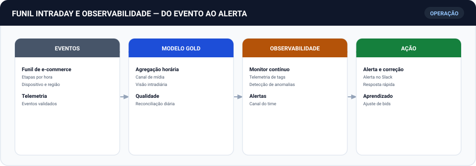
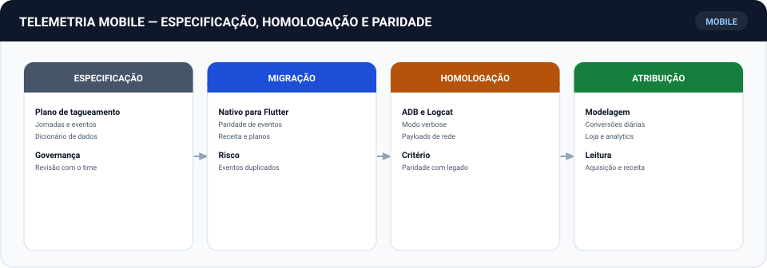
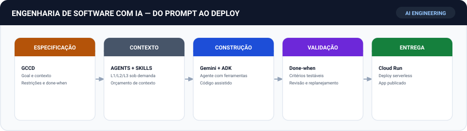
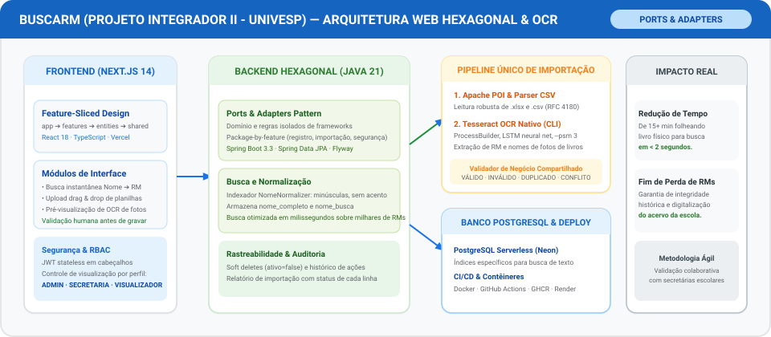

<div align="center">

# 📊 Paulo Marcos Ordonha da Silva
### **Analytics Engineer | AI Engineering & Agentic Systems | Data Architecture**

[](https://linkedin.com/in/paulo-marcos-ordonha)
[](https://github.com/mordonha)
[](mailto:marcos.ordonha@gmail.com)
[](./Portfolio_Paulo_Ordonha_Analytics_Engineer.pdf)

<p align="center">
  <b>Ourinhos, SP — Brasil</b> • Bacharelado em Ciência de Dados (UNIVESP) • Ex-Sistemas de Informação (ICMC-USP)
</p>

---

</div>

## 🎯 Perfil Profissional & Visão Executiva

Profissional de **Dados & Analytics AI-native** com sólida fundamentação em **Ciência de Dados e Engenharia de Software**. Trajetória ponta a ponta: desde a governança e coleta precisa de dados em ecossistemas Web e Mobile complexos (**GTM Server-Side, CAPI, Firebase SDK, DataLayer**) até a modelagem de data lakes analíticos em nuvem sob **arquitetura medalhão (BigQuery, Dataform)**, observabilidade serverless contínua e automações com **Agentic Analytics (Claude Code, MCP)**. Nos últimos meses, aprofundei **engenharia de software assistida por IA** — GCCD, context engineering (`AGENTS.md`/`SKILL.md`), agentes com ferramentas e critérios de avaliação — aplicada em produto próprio (StudyFlow) e em laboratório com Google ADK.

Atuação técnica em projetos de alto impacto em setores de alto volume e ambientes regulados:

* **Varejo & E-commerce (B2C e B2B)**
* **Telecomunicações & Mobilidade**
* **Fintech & Meios de Pagamento**
* **Serviços & Gestão Funerária**
* **Transporte Rodoviário**

> **Confidencialidade e propriedade intelectual.** Os cases são descritos em nível de capacidade e de impacto, sem nomes de clientes ou agências, sem identificadores de contêineres, propriedades, aplicativos ou endpoints, sem esquemas de dados, regras de negócio ou trechos de código proprietários. Métricas são qualitativas ou arredondadas; números específicos só são divulgados com autorização escrita. Nenhum dado pessoal de titulares é publicado; projetos acadêmicos usam dados sintéticos ou anonimizados. Detalhes de implementação podem ser discutidos em entrevista, sob NDA.

---

## 🤖 Foco em IA & Sistemas Agênticos

- **Engenharia de software assistida por IA:** método GCCD (Goal, Context, Constraints, Done-when), especificação antes do código e critérios de aceite verificáveis.
- **Context engineering:** `AGENTS.md` com fatos duráveis e `SKILL.md` com divulgação progressiva (L1/L2/L3), carregando contexto sob demanda em vez de inflar o prompt.
- **Agentes com guardrails:** Google ADK, MCP e Claude Code; ferramentas restritas, segredos protegidos e validação de saída antes de produção.
- **Avaliação e confiabilidade:** testes, assertions, reconciliação e observabilidade — a IA só entra em produção com critério de "feito".

> Case completo: **Case 7 — StudyFlow & Agent Lab**, na Parte 2.

---

## 🧭 Frameworks Metodológicos: KDD & CRISP-DM

Todos os projetos do portfólio são conduzidos sob rigor científico e orientação a valor de negócio, integrando os dois principais frameworks da ciência de dados:

```
┌────────────────────────────────────────────────────────────────────────────────────────────────────────┐
│                              INTEGRAÇÃO METODOLÓGICA: KDD & CRISP-DM NO ANALYTICS                      │
├────────────────────────────────┬───────────────────────────────┬───────────────────────────────────────┤
│ FASE CRISP-DM (Negócio)        │ FASE KDD (Técnica/Científica) │ IMPLEMENTAÇÃO NO ANALYTICS LAKEHOUSE  │
├────────────────────────────────┼───────────────────────────────┼───────────────────────────────────────┤
│ 1. Business Understanding      │ Definição do Escopo & Domínio │ Mapeamento de OKRs, KPIs e Dicionário │
│ 2. Data Understanding          │ Data Selection (Seleção)      │ Ingestão Raw / Bronze & Auditoria     │
│ 3. Data Preparation            │ Pre-processing & Cleaning     │ Camada Silver (Deduplicação / Filtros)│
│ 4. Modeling                    │ Transformation & Data Mining  │ Camada Gold (Dataform, Funis, CAPI)   │
│ 5. Evaluation                  │ Interpretation & Evaluation   │ Assertions, Reconciliação e Testes    │
│ 6. Deployment                  │ Knowledge Deployment          │ Dashboards BI, Alertas e IA Agentic   │
└────────────────────────────────┴───────────────────────────────┴───────────────────────────────────────┘
```

---

# 🚀 PARTE 1: CASES PROFISSIONAIS

---

### Case 1: Serviços Funerários — Data Lake Medalhão & Pipelines ELT Incrementais
> **Segmento:** Planos & Serviços Funerários / Cemiteriais  
> **Tecnologias:** Google BigQuery, Dataform (SQLX), APIs de mídia, GA4 Export, Metabase

#### 📌 Contexto & Desafio de Negócio (CRISP-DM: Business & Data Understanding)
O cliente necessitava unificar dados fragmentados de campanhas de mídia paga, captação de leads via site/WhatsApp e transações de múltiplas unidades. Havia risco de duplicação de dados, disparidades de métricas entre canais e lentidão na atualização de relatórios executivos.

#### ⚙️ Solução Arquitetural & Aplicação do KDD
* **Data Selection & Ingestão (Bronze):** coleta automatizada de dados brutos das APIs de mídia e export analítico, com segmentação por conta e data.
* **Pre-processing (Silver):** normalização de tipagens, casting de moeda, tratamento de nulos e dimensão de campanhas com regra de correspondência entre identificadores.
* **Transformation & Idempotência (Dataform Engine):** pipeline incremental com janela de reprocessamento para absorver conversões tardias e operações idempotentes antes da inserção.
* **Data Quality:** testes automatizados de unicidade e não-nulidade antes da camada de consumo, impedindo a poluição da camada Gold.

<div align="center">
  
</div>

#### 📈 Resultados & Impacto Mensurável
* Deduplicação validada por testes executados em tempo de compilação do pipeline.
* Otimização de custos de processamento no BigQuery com particionamento diário e clustering pelas chaves de consulta mais frequentes.
* Visão consolidada de CPL e CPA por unidade entregue em dashboards no Metabase para suporte à liderança.

---

### Case 2: Varejo B2B — Tracking Cross-Domain com Pseudonimização no Cliente
> **Segmento:** Varejo B2B / Equipamentos & Locação  
> **Tecnologias:** Google Tag Manager, JavaScript, Web Cryptography API, `window.postMessage`, Meta CAPI

#### 📌 Contexto & Desafio de Negócio (CRISP-DM: Business Understanding & Privacy)
Landing pages B2B com formulários críticos carregados via iframe, hospedados em infraestrutura de middleware. O desafio consistia em:
1. Rastrear a conversão no domínio pai sem quebrar a atribuição de mídia;
2. Não registrar conversões quando a API de gravação falhasse;
3. Não trafegar dados pessoais (PII) em texto aberto no front-end.

#### ⚙️ Solução Arquitetural & Segurança na Borda
* **Validação condicional de sucesso:** o evento de conversão só é disparado após a confirmação de persistência no backend.
* **Pseudonimização no cliente:** hash SHA-256 de e-mail, nome e telefone calculado na memória do navegador antes de qualquer envio. Hash é pseudonimização — o dado continua sendo pessoal e deve ser tratado como tal.
* **Comunicação segura cross-domain:** envio dos identificadores pseudonimizados ao domínio pai via `window.postMessage`, onde o GTM captura o evento e despacha para GA4 e Meta CAPI (Advanced Matching).

<div align="center">
  
</div>

#### 📈 Resultados & Impacto Mensurável
* Conversões registradas apenas após confirmação do backend, eliminando disparos por abandono ou erro de formulário.
* PII pseudonimizada antes da injeção no `dataLayer`.
* Melhora na taxa de cruzamento de conversões em Meta Ads e Google Ads Enhanced Conversions.

---

### Case 3: E-commerce LATAM — Tracking Híbrido Server-Side & Reconciliação de Atribuição
> **Segmento:** Cosméticos & Beleza / E-commerce de Altíssimo Volume  
> **Tecnologias:** GTM Web & Server-Side, GCP, Meta Conversions API (CAPI), Pinterest CAPI, BigQuery

#### 📌 Contexto & Desafio de Negócio (KDD: Data Cleaning & Pre-processing)
Com as restrições do Apple Safari ITP e o uso crescente de adblockers, e-commerces de grande volume na América Latina sofriam com perda de atribuição de mídia e inconsistências volumétricas de receita entre o GA4 e o BigQuery.

#### ⚙️ Solução Arquitetural & Engenharia de Dados
* **Coleta server-side em infraestrutura first-party:** proxy próprio para restabelecer a longevidade dos cookies de navegação e proteger identificadores de sessão.
* **Integração de APIs de conversão (CAPI):** despacho simultâneo de eventos de e-commerce (`purchase`, `add_to_cart`) via servidor para Meta e Pinterest, com resiliência a bloqueadores no navegador.
* **Reconciliação GA4 x BigQuery:** auditorias de causa-raiz para eliminar quebras de sessão em gateways de pagamento e garantir consistência das tabelas analíticas que alimentam modelos de **LTV, CAC e propensão**.

<div align="center">
  
</div>

#### 📈 Resultados & Impacto Mensurável
* Recuperação relevante da atribuição antes perdida por ITP e bloqueadores.
* Reconciliação entre transações de back-office e eventos analíticos, validada com o time de negócio.
* Sinais de conversão íntegros alimentando os algoritmos de Smart Bidding.

---

### Case 4: Fintech de Meios de Pagamento — Auditoria de Contêiner & Core Web Vitals
> **Segmento:** Meios de Pagamento / Banking & Card Infrastructure  
> **Tecnologias:** Google Tag Manager, JavaScript, Core Web Vitals, CMP

#### 📌 Contexto & Desafio de Negócio (CRISP-DM: Evaluation & Performance)
As landing pages de produtos críticos enfrentavam lentidão de carregamento, com altos tempos de bloqueio de thread (TBT) e notas desfavoráveis de **LCP** e **INP**, além de elevar o CPC em virtude de baixos índices de qualidade no Google Ads.

#### ⚙️ Diagnóstico & Ações de Otimização
* **Expurgo em lote de código morto:** auditoria do contêiner de tags e remoção de um grande volume de tags legadas de uma versão anterior do analytics, que inflavam o download do arquivo.
* **Eliminação de scripts obsoletos:** remoção de uma ferramenta de experimentação descontinuada que causava atraso de renderização por *flicker*.
* **Desduplicação de rastreio:** eliminação de ferramentas concorrentes de gravação de sessão e reprogramação de disparos de remarketing para o evento **Window Loaded (`gtm.load`)**, liberando a CPU para renderizar os elementos visuais antes dos scripts de mídia.
* **Governança de privacidade:** revisão da tag da CMP e regularização do fluxo de consentimento.

<div align="center">
  
</div>

#### 📈 Resultados & Impacto Mensurável
* Redução do peso do contêiner de tags transferido pela rede.
* Desobstrução da main thread do navegador, melhorando **LCP**, **INP** e **TBT** em dispositivos móveis.
* Elevação do Índice de Qualidade das landing pages no Google Ads e consentimento de cookies regularizado.

---

### Case 5: Transporte Rodoviário — Funil Intraday & Observabilidade Serverless
> **Segmento:** Transporte Rodoviário & E-commerce de Passagens  
> **Tecnologias:** BigQuery, GCP Cloud Run, Claude Code, Model Context Protocol (MCP), Metabase API, Slack Webhooks

#### 📌 Contexto & Desafio de Negócio (CRISP-DM: Modeling & Deployment)
1. **Intraday e-commerce:** necessidade de visibilidade horária do funil de conversão de passagens para ajustar bids de mídia ao longo do dia, antes do fechamento noturno.
2. **Quedas de tracking:** alterações no front-end frequentemente causavam quebras silenciosas no DataLayer sem que os times técnicos soubessem em tempo hábil.
3. **Agilidade em relatórios:** consultas exploratórias complexas demoravam dias para serem convertidas em dashboards de negócio.

#### ⚙️ Solução Arquitetural
* **Modelagem intraday horária:** modelo na camada Gold agregando as etapas de e-commerce (`view_item → add_to_cart → begin_checkout → purchase`) por hora, dispositivo, canal de mídia e região.
* **Observabilidade serverless contínua:** listener em **GCP Cloud Run** monitorando telemetria de tags, com detecção de anomalias volumétricas e alertas em canal do **Slack**.
* **Workflows de Agentic Analytics:** aceleração da criação de dashboards conectando o assistente de IA **Claude Code** à API do Metabase via **MCP**, com geração de consultas SQL validadas sobre a camada Gold.

<div align="center">
  
</div>

#### 📈 Resultados & Impacto Mensurável
* Visibilidade intradiária permitindo realocação tática de verba de mídia.
* Redução do tempo de detecção e resposta a falhas de tagueamento.
* Entrega acelerada de cards analíticos no Metabase com pipelines assistidos por IA.

---

### Case 6: Telecomunicações — Telemetria Mobile & Migração Flutter
> **Segmento:** Telecomunicações & Apps Nativos  
> **Tecnologias:** Firebase Analytics SDK, Google Analytics 4, Android Studio, ADB (Android Debug Bridge), Flutter

#### 📌 Contexto & Desafio de Negócio
Garantir a precisão da telemetria durante a reescrita técnica completa de um aplicativo de telecomunicações da arquitetura nativa (Kotlin/Swift) para **Flutter**, em conjunto com uma consultoria de tecnologia, preservando os modelos de conversão de planos e recargas.

#### ⚙️ Engenharia & Homologação Técnica
* **Especificação de planos de tagueamento:** definição formal de parâmetros para fluxos de autosserviço, pagamento e contratação de serviços.
* **Validação via ADB em nível verbose:** homologação de payloads de rede e eventos em emuladores e dispositivos físicos:
  ```powershell
  adb shell setprop log.tag.FA-SVC VERBOSE
  adb shell setprop debug.firebase.analytics.app <applicationId>
  adb shell setprop log.tag.GAv4 DEBUG
  ```
* **Inspeção de Logcat:** filtragem seletiva de eventos `tag.FA-SVC message: logging` para certificar paridade de dados com a versão legada.

<div align="center">
  
</div>

#### 📈 Resultados & Impacto Mensurável
* Go-live da versão Flutter com paridade de eventos de conversão de planos e recargas na janela de homologação.
* Redução de chamados de inconsistência de dados no pós-lançamento.
* Paridade de métricas de aquisição entre a loja de aplicativos e o GA4.

---

# 🤖 PARTE 2: AI ENGINEERING & SISTEMAS AGÊNTICOS

---

### Case 7: StudyFlow & Agent Lab — Engenharia de Software com IA, do Prompt ao Deploy
> **Contexto:** projeto de formação (Alura + Google) e aplicação própria, sem dados de clientes  
> **Tecnologias:** Google AI Studio (Gemini), Google ADK, Python, React 19, TypeScript, Vite, Tailwind CSS v4, Google Cloud Run

#### 📌 Contexto & Desafio de Negócio (CRISP-DM: Business Understanding)
O objetivo era construir um produto real — um app de organização de objetivos de estudo — em uma imersão de engenharia de software com IA, da ideação ao deploy serverless. O desafio não era gerar código: era especificar antes de codar, fornecer contexto suficiente ao modelo, restringir o escopo e definir critérios de aceite verificáveis para não aceitar uma saída "aparentemente boa".

#### ⚙️ Solução: GCCD + Context Engineering + Harness
* **Especificação antes do código (GCCD):** Goal, Context, Constraints e Done-when em três prompts encadeados (descoberta, requisitos, implementação), com a diretiva "não escreva código ainda" separando requisitos de solução.
* **Context engineering:** `AGENTS.md` com fatos duráveis (persona, ambiente, convenções, segredos) e `SKILL.md` com divulgação progressiva L1/L2/L3, carregando referências sob demanda em vez de despejar todo o contexto no prompt.
* **Harness e loop:** ferramentas restritas (somente leitura/escrita de arquivos, sem shell), segredos fora do versionamento, critérios done-when em checkboxes e ciclo de teste/replanejamento.
* **Produto:** React 19 + TypeScript + Vite + Tailwind v4; `StorageService` para localStorage com tratamento de erro e seed data; modais acessíveis; 10 critérios de aceite validados.
* **Agente (laboratório):** especificação de agente Google ADK em Python com `SkillToolset`, `EnvironmentToolset`, regra de gating e 7 critérios done-when.
* **Economia de tokens:** menos iterações de retrabalho, contexto reutilizável e foco em valor por token, não em volume.

<div align="center">
  
</div>

#### 📈 Resultados & Evidências
* App StudyFlow com **10/10 critérios de aceite** validados e build/deploy serverless no Cloud Run.
* Especificação de agente com **7 critérios done-when**, ferramentas restritas e segredos protegidos.
* **4 diagramas de arquitetura** versionados: especificação, planejamento, implementação e validação.
* Método reutilizável: GCCD + AGENTS/SKILLS + done-when para novos agentes.
* Repositório público: [github.com/mordonha/StudyFlow---APP](https://github.com/mordonha/StudyFlow---APP)

---

# 🎓 PARTE 3: CASES ACADÊMICOS

---

### Case Acadêmico 1: BuscaRM — Aplicação Web Colaborativa Hexagonal com OCR
> **Instituição:** UNIVESP — Projeto Integrador em Computação II (PJ240)  
> **Stack:** Java 21, Spring Boot 3.3, Next.js 14 (App Router), TypeScript, PostgreSQL, Tesseract OCR, Apache POI, Docker, GitHub Actions  
> **Nota:** projeto acadêmico próprio. O repositório e as demonstrações usam dados sintéticos/anonimizados; nenhum dado real de titular é publicado.

#### 📌 Contexto do Problema & Impacto Social
Secretarias de escolas públicas lidavam com um processo arcaico de busca manual no livro físico de Registro de Matrícula (RM), folheando livros deteriorados com milhares de registros para localizar prontuários físicos de ex-alunos. A lentidão chegava a 15-20 minutos por atendimento, com registros perdidos ao longo das décadas.

#### ⚙️ Arquitetura de Software & Destaques de Engenharia
* **Backend Hexagonal (Ports & Adapters):** domínio isolado de frameworks, organizado no padrão *package-by-feature* (`registro`, `importacao`, `usuario`, `seguranca`).
* **Frontend Feature-Sliced Design:** interface moderna em Next.js 14 com direção estrita de dependências (`app ➔ features ➔ entities ➔ shared`).
* **Pipeline de Importação Único & OCR:**
  * Leitura e validação de planilhas Excel (.xlsx via Apache POI) e arquivos CSV (parser próprio RFC 4180).
  * Extração automatizada de fotos de livros antigos utilizando o binário nativo do **Tesseract OCR (LSTM neural network, `--psm 3`)** orquestrado via `ProcessBuilder`.
  * **Regra de Ouro (Human-in-the-loop):** nenhuma importação grava direto no cadastro. O fluxo sempre passa por **validar ➔ pré-visualizar ➔ confirmar com decisão humana**, classificando os itens em `VÁLIDO`, `INVÁLIDO`, `DUPLICADO` e `CONFLITO`.
* **Motor de Busca Otimizado:** indexador `NomeNormalizer` (minúsculas, remoção de acentos e formato canônico) com índices dedicados no PostgreSQL, permitindo busca instantânea acento-insensível.
* **Segurança e Auditoria:** autenticação stateless via JWT com RBAC (`ADMIN`, `SECRETARIA`, `VISUALIZADOR`) e rastreabilidade total de auditoria e *soft delete*.

<div align="center">
  
</div>

#### 📈 Impacto Comprovado na Validação
* **Redução do tempo de busca de 15 minutos para menos de 2 segundos.**
* Eliminação do risco de perda de registros históricos e digitalização do acervo com validação direta das secretárias escolares.

---

### Case Acadêmico 2: Mineração de Dados & Metodologia Científica Aplicada
> **Instituição:** UNIVESP — Mineração de Dados (COM360) / DATA ICMC (USP)  
> **Tópicos:** KDD Process, CRISP-DM, Estatística Inferencial, Pré-processamento Científico, Machine Learning Supervisionado  
> **Nota:** estudos sobre bases públicas ou anonimizadas.

#### 📌 Contexto & Fundamentação Teórica
Estudos aprofundados na formalização metodológica da Descoberta de Conhecimento em Bases de Dados (**KDD**) e no padrão de mercado **CRISP-DM**, investigando a evolução da ciência de dados rumo ao Quarto Paradigma (*E-Science* / Gray, Kuhn) e aplicando algoritmos de mineração sobre conjuntos de dados complexos (bases de atendimento de CRM e dados públicos de saúde, sempre anonimizados).

#### ⚙️ Laboratórios & Técnicas Implementadas
1. **Pré-processamento Científico & Tratamento de Anomalias:**
   * **Incompletude (Valores Ausentes):** imputação estatística via média/moda por classe e métodos de *hot-deck* / última observação.
   * **Ruídos & Outliers:** detecção analítica por Range Interquartil (IQR/Boxplot) e suavização por *binning* (encaixotamento de mesma frequência/largura).
   * **Transformação & Escalonamento:** Normalização Z-Score, Min-Max Scaling e codificação de atributos categóricos (*One-Hot Encoding* e *Label Encoding*).
   * **Redução de Dimensionalidade:** aplicação de PCA (Análise de Componentes Principais) e seleção de atributos para mitigar o trade-off de complexidade computacional.
2. **Modelagem Preditiva & Classificação Supervisionada:**
   * Implementação de classificadores baseados em Teorema de Bayes (Naive Bayes), Árvores de Decisão e Regressão Logística.
   * **Validação Cruzada Rigorosa:** emprego de **Stratified 10-Fold Cross-Validation** (conforme literatura de Kohavi) para dados tabulares i.i.d., com mitigação de *data leakage* via `StratifiedGroupKFold` e particionamento temporal (`TimeSeriesSplit`) para evitar viés de previsão futura (*look-ahead bias*).

<div align="center">
  
</div>

#### 📈 Conexão Academia-Indústria
A base teórica e prática do KDD e CRISP-DM consolidada na universidade serve de alicerce direto para as decisões arquiteturais tomadas em ambientes de produção corporativos, como na estruturação das camadas Bronze, Silver e Gold em data lakes analíticos.

---

## 🛠️ Matriz Geral de Tecnologias

| Domínio | Ferramentas & Stacks |
| :--- | :--- |
| **Linguagens de Programação** | SQL (Avançado), Python (Pandas, NumPy, Scikit-Learn), JavaScript / TypeScript, Java 21 |
| **Data Engineering & Lakehouse** | Google BigQuery, Dataform (SQLX), PostgreSQL, MySQL, Arquitetura Medalhão, ETL/ELT |
| **Tracking, Telemetria & Tagging** | Google Tag Manager (Web & Server-Side), Meta CAPI, Pinterest CAPI, Firebase Analytics SDK, DataLayer |
| **Cloud & DevOps** | GCP (Cloud Run, Cloud Monitoring), Docker, GitHub Actions (CI/CD), Flyway, Linux |
| **BI & Agentic Analytics** | Metabase (API & MCP), Looker Studio, Claude Code, Model Context Protocol (MCP) |
| **AI Engineering & Agents** | Google AI Studio (Gemini), Google ADK (Python), GCCD, AGENTS.md/SKILL.md, MCP, Claude Code |
| **Desenvolvimento de Software** | Spring Boot 3.3, Next.js 14, React 18, Hexagonal Architecture, Tesseract OCR |

---

## 🔐 Nota de Confidencialidade

Este portfólio descreve experiências profissionais em **nível de capacidade**, não de implementação proprietária. Não são divulgados: nomes de clientes ou agências, identificadores de contêineres, propriedades ou aplicativos, endpoints, esquemas de dados, regras de negócio, trechos de código de terceiros ou métricas confidenciais. Números específicos somente com autorização escrita. Marcas eventualmente citadas pertencem aos seus titulares e são mencionadas apenas para fins descritivos, sem sugerir endosso. Este material não constitui certificação de conformidade legal de terceiros.

---

## 📬 Contato & Conexões

- **Nome:** Paulo Marcos Ordonha da Silva
- **Localização:** Ourinhos, SP — Brasil (Disponível para atuação remota ou híbrida)
- **Email:** [marcos.ordonha@gmail.com](mailto:marcos.ordonha@gmail.com)
- **LinkedIn:** [linkedin.com/in/paulo-marcos-ordonha](https://linkedin.com/in/paulo-marcos-ordonha)
- **GitHub:** [github.com/mordonha](https://github.com/mordonha)

---
<div align="center">
  <sub>Portfólio estruturado e mantido com rigor metodológico e arquitetural. Cases anonimizados por confidencialidade. © 2026 Paulo Marcos Ordonha da Silva</sub>
</div>
