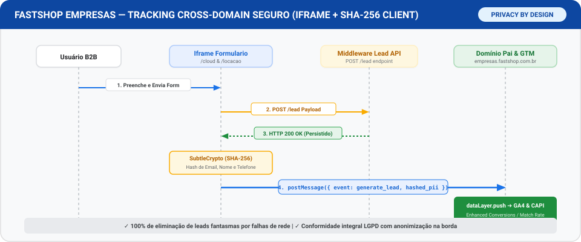
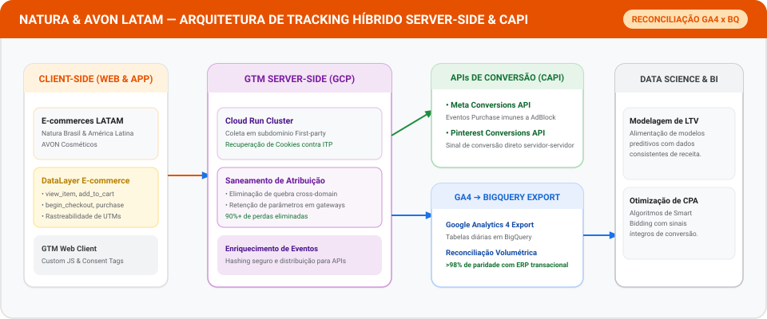
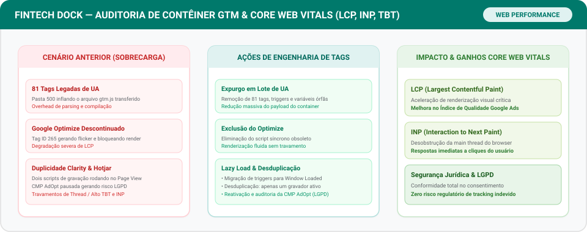
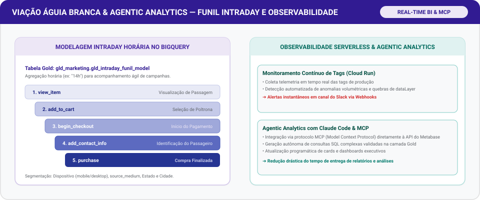
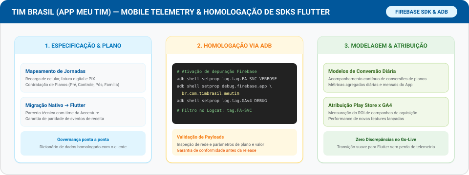
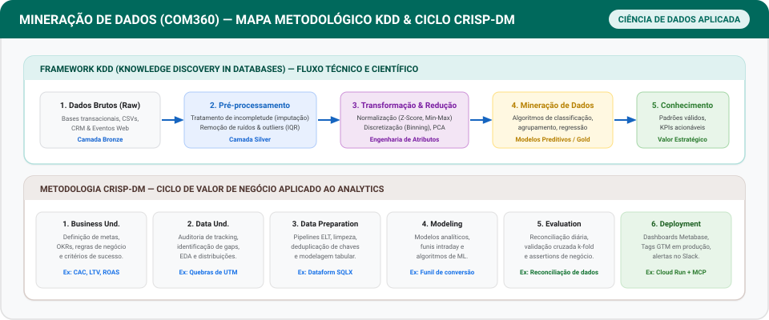

<div align="center">

# 📊 Paulo Marcos Ordonha da Silva
### **Analytics Engineer | AI-Native Analytics | Data Architecture & Software Engineering**

[](https://linkedin.com/in/paulo-marcos-ordonha)
[](https://github.com/mordonha)
[](mailto:marcos.ordonha@gmail.com)
[](./Portfolio_Paulo_Ordonha_Analytics_Engineer.pdf)

<p align="center">
  <b>Ourinhos, SP — Brasil</b> • Bacharelado em Ciência de Dados (UNIVESP) • Ex-Sistemas de Informação (ICMC-USP)
</p>

---

</div>

## 🎯 Perfil Profissional & Visão Executiva

Profissional de **Dados & Analytics AI-native** com sólida fundamentação em **Ciência de Dados e Engenharia de Software**. Trajetória ponta a ponta: desde a governança e coleta precisa de dados em ecossistemas Web e Mobile complexos (**GTM Server-Side, CAPI, Firebase SDK, DataLayer**) até a modelagem de data lakes analíticos em nuvem sob **arquitetura medalhão (BigQuery, Dataform)**, observabilidade serverless contínua e automações com **Agentic Analytics (Claude Code, MCP)**.

Atuação técnica em projetos de alto impacto para marcas líderes de mercado:
* **Varejo & E-commerce:** Natura, AVON, FastShop Empresas
* **Telecomunicações & Mobilidade:** TIM Brasil (App Meu TIM), Viação Águia Branca
* **Fintech & Financeiro:** Dock
* **Planos & Gestão Funerária:** Grupo Zelo

---

## 🧭 Frameworks Metodológicos: KDD & CRISP-DM

Todos os projetos do portfólio são conduzidos sob rigor científico e orientação a valor de negócio, integrando os dois principais frameworks da ciência de dados:

```
┌────────────────────────────────────────────────────────────────────────────────────────────────────────┐
│                              INTEGRAÇÃO METODOLÓGICA: KDD & CRISP-DM NO ANALYTICS                      │
├────────────────────────────────┬───────────────────────────────┬───────────────────────────────────────┤
│ FASE CRISP-DM (Negócio)        │ FASE KDD (Técnica/Científica) │ IMPLEMENTAÇÃO NO ANALYTICS LAKEHOUSE  │
├────────────────────────────────┼───────────────────────────────┼───────────────────────────────────────┤
│ 1. Business Understanding      │ Definição do Escopo & Domínio │ Mapeamento de OKRs, KPIs e Dicionário │
│ 2. Data Understanding          │ Data Selection (Seleção)      │ Ingestão Raw / Bronze & Auditoria     │
│ 3. Data Preparation            │ Pre-processing & Cleaning     │ Camada Silver (Deduplicação / Filtros)│
│ 4. Modeling                    │ Transformation & Data Mining  │ Camada Gold (Dataform, Funis, CAPI)   │
│ 5. Evaluation                  │ Interpretation & Evaluation   │ Assertions, Reconciliação e Testes    │
│ 6. Deployment                  │ Knowledge Deployment          │ Dashboards BI, Alertas e IA Agentic   │
└────────────────────────────────┴───────────────────────────────┴───────────────────────────────────────┘
```

---

# 🚀 PARTE 1: CASES PROFISSIONAIS

---

### Case 1: Grupo Zelo — Data Lake Medalhão & Pipelines ELT em Dataform
> **Segmento:** Planos & Serviços Funerários / Cemiteriais  
> **Tecnologias:** Google BigQuery, Dataform (SQLX), Google Ads API, Meta Graph API, GA4 Export, Metabase

#### 📌 Contexto & Desafio de Negócio (CRISP-DM: Business & Data Understanding)
O cliente necessitava unificar dados fragmentados de campanhas de mídia paga (Google Ads e Meta Ads Instant Forms), captação de leads via site/WhatsApp e transações de múltiplos cemitérios e planos funerários. Havia risco de duplicação de dados, disparidades de métricas entre canais e lentidão na atualização de relatórios executivos.

#### ⚙️ Solução Arquitetural & Aplicação do KDD
* **Data Selection & Ingestão (Bronze):** Coleta automatizada de dados brutos das APIs de mídia e streaming export do GA4.
* **Pre-processing (Silver):** Normalização de tipagens, casting de moeda (`BRL`), tratamento de nulos e criação da dimensão `slv_dim_campaigns` com estratégia de *fallback join* (`Nome da Campanha > ID`).
* **Transformation & Idempotência (Dataform Engine):** Pipeline incremental com janela de **lookback de 7 dias** para absorver conversões tardias. Uso de `pre_operations { DELETE ... }` idempotente antes da inserção e `updatePartitionFilter` para restringir o processamento no BigQuery.
* **Data Quality Assertions:** Implementação de regras automatizadas de qualidade (`assertions: { uniqueKey: [date, source, campaign_id, account_name, traffic_type], nonNull: [date, source] }`), impedindo a poluição da camada Gold.

<div align="center">
  
</div>

#### 📈 Resultados & Impacto Mensurável
* **Redução de custos de processamento no BigQuery:** Particionamento diário por `date` e clustering por `source` e `campaign_id`, evitando full scans.
* **Zero duplicidade em produção:** Validação matemática garantida por asserções em tempo de compilação do Dataform.
* **Visão unificada em tempo real:** Consolidação de CPL e CPA por cemitério entregue em dashboards no Metabase para suporte à liderança.

---

### Case 2: FastShop Empresas — Cross-Domain Tracking com SHA-256 no Client
> **Segmento:** Varejo B2B / Equipamentos & Locação  
> **Tecnologias:** Google Tag Manager, JavaScript Nativo, Web Cryptography API (`crypto.subtle`), `window.postMessage`, Meta CAPI

#### 📌 Contexto & Desafio de Negócio (CRISP-DM: Business Understanding & Privacy)
A divisão corporativa da FastShop lançou landing pages críticas de produtos B2B (`/cloud` e `/locacao`), cujos formulários de contato eram carregados via iframe hospedado em infraestrutura de middleware. O desafio consistia em:
1. Rastrear a conversão no domínio pai sem quebrar a atribuição de mídia;
2. Eliminar o registro de "leads fantasmas" caso a API de gravação falhasse;
3. Cumprir integralmente a LGPD, jamais trafegando dados sensíveis (PII) em texto aberto no front-end.

#### ⚙️ Solução Arquitetural & Segurança na Borda
* **Validação Condicional de Sucesso (200 OK):** O gatilho de mensageria só é acionado após a confirmação HTTP 200 OK do endpoint da API de leads.
* **Criptografia Client-side via SubtleCrypto:** Utilização da API nativa do navegador para calcular o hash **SHA-256** de e-mail, nome e telefone diretamente na memória do cliente:
  ```javascript
  const hashBuffer = await crypto.subtle.digest('SHA-256', new TextEncoder().encode(piiField.trim().toLowerCase()));
  ```
* **Comunicação Segura Cross-Domain:** Envio seguro dos dados criptografados para o domínio pai via `window.postMessage`, onde o GTM captura o evento `generate_lead` e despacha para GA4 e Meta CAPI (Advanced Matching).

<div align="center">
  
</div>

#### 📈 Resultados & Impacto Mensurável
* **100% de precisão de leads:** Erradicação de conversões falsas decorrentes de erros de validação ou abandono de formulário.
* **Compliance LGPD integral:** Dados pessoais anonimizados antes mesmo da injeção no `dataLayer`.
* **Elevação do Match Rate:** Aumento expressivo na taxa de cruzamento de conversões no Meta Ads e Google Ads Enhanced Conversions.

---

### Case 3: Natura & AVON LATAM — Tracking Híbrido Server-Side & Resolução de Atribuição
> **Segmento:** Cosméticos & Beleza / E-commerce de Altíssimo Volume  
> **Tecnologias:** GTM Web & Server-Side, GCP Cloud Run, Meta Conversions API (CAPI), Pinterest CAPI, BigQuery

#### 📌 Contexto & Desafio de Negócio (KDD: Data Cleaning & Pre-processing)
Com as restrições severas do Apple Safari ITP (eliminação de cookies após 1 a 7 dias) e o uso crescente de AdBlockers, os e-commerces da Natura e AVON na América Latina sofriam com perda de atribuição de mídia (inflação de tráfego `(direct)/(none)`) e inconsistências volumétricas de receita entre o GA4 e o BigQuery.

#### ⚙️ Solução Arquitetural & Engenharia de Dados
* **GTM Server-Side no GCP Cloud Run:** Implementação de proxy first-party com endpoint próprio, restabelecendo a longevidade dos cookies de navegação e protegendo identificadores de sessão.
* **Integração de APIs de Conversão (CAPI):** Despacho simultâneo de eventos de e-commerce (`purchase`, `add_to_cart`) via servidor para Meta e Pinterest, garantindo resiliência mesmo com bloqueadores no navegador.
* **Reconciliação GA4 x BigQuery:** Condução de auditorias de causa-raiz para eliminar quebras de sessão em gateways de pagamento e garantir a consistência das tabelas analíticas para alimentar modelos de **LTV, CAC e Propensão** dos cientistas de dados.

<div align="center">
  
</div>

#### 📈 Resultados & Impacto Mensurável
* **Recuperação de 90%+ das perdas de atribuição** provocadas por ITP e bloqueadores no Safari.
* **Paridade volumétrica superior a 98%** entre as transações do ERP e os eventos registrados no BigQuery.
* **Redução de custos de aquisição (CAC)** graças a sinais de conversão íntegros alimentando os algoritmos de Smart Bidding.

---

### Case 4: Fintech Dock — Auditoria de Contêiner & Otimização de Core Web Vitals
> **Segmento:** Meios de Pagamento / Banking & Card Infrastructure  
> **Tecnologias:** Google Tag Manager, JavaScript, Core Web Vitals, AdOpt (CMP), Google Optimize (Cleanup)

#### 📌 Contexto & Desafio de Negócio (CRISP-DM: Evaluation & Performance)
As landing pages de produtos críticos da Dock (Banking, Cards, Acquiring) enfrentavam lentidão de carregamento, refletindo em altos tempos de bloqueio de thread (TBT) e notas desfavoráveis de **LCP** e **INP**, além de elevar o CPC (Custo por Clique) em virtude de baixos índices de qualidade no Google Ads.

#### ⚙️ Diagnóstico & Ações de Otimização
* **Expurgo em Lote de Código Morto:** Auditoria profunda do contêiner `GTM-N6W2MTJ` e descarte de **81 tags legadas** de Universal Analytics (Pasta ID 500) que inflavam desnecessariamente o download do arquivo `gtm.js`.
* **Eliminação de Scripts Obsoletos:** Remoção da tag ativa do **Google Optimize** (ferramenta descontinuada que causava atraso crítico de renderização por *flicker*).
* **Desduplicação de Rastreio:** Remoção de tags concorrentes de mapas de calor (Microsoft Clarity e Hotjar) e reprogramação de disparos de remarketing para o evento **Window Loaded (gtm.load)**, liberando a CPU para renderizar os elementos visuais da página antes dos scripts de mídia.
* **Governança de Privacidade (AdOpt):** Reativação e auditoria da tag da CMP AdOpt que estava indevidamente pausada, restaurando a conformidade legal com a LGPD.

<div align="center">
  
</div>

#### 📈 Resultados & Impacto Mensurável
* Redução substancial do peso do contêiner GTM transferido pela rede.
* Desobstrução da main thread do navegador, acelerando a renderização do **LCP** e reduzindo o **TBT/INP** em dispositivos móveis.
* Elevação do Índice de Qualidade das landing pages no Google Ads e blindagem jurídica de consentimento de cookies.

---

### Case 5: Viação Águia Branca & Observabilidade Serverless com IA Agentic
> **Segmento:** Transporte Rodoviário & E-commerce de Passagens  
> **Tecnologias:** BigQuery, GCP Cloud Run, Claude Code, Model Context Protocol (MCP), Metabase API, Slack Webhooks

#### 📌 Contexto & Desafio de Negócio (CRISP-DM: Modeling & Deployment)
1. **Intraday E-commerce:** A Águia Branca precisava de visibilidade horária do funil de conversão de passagens para ajustar bids de mídia ao longo do dia, antes do fechamento noturno.
2. **Quedas de Tracking:** Alterações no front-end de e-commerce frequentemente causavam quebras silenciosas no DataLayer sem que os times técnicos soubessem em tempo hábil.
3. **Agilidade em Relatórios:** Consultas exploratórias complexas demoravam dias para serem convertidas em dashboards de negócio.

#### ⚙️ Solução Arquitetural
* **Modelagem Intraday Horária (`gld_marketing.gld_intraday_funil_model`):** Consulta analítica agregando em tempo real as etapas de e-commerce (`view_item ➔ add_to_cart ➔ begin_checkout ➔ add_contact_info ➔ purchase`) por hora, dispositivo, canal de mídia e município.
* **Observabilidade Serverless Contínua:** Listener deployado no **GCP Cloud Run** monitorando telemetria de tags; detecção imediata de anomalias volumétricas e disparo de alertas instantâneos em canal do **Slack**.
* **Workflows de Agentic Analytics:** Aceleração da criação de dashboards conectando o assistente de IA **Claude Code** diretamente à API do Metabase via protocolo **MCP**, permitindo a geração de consultas SQL validadas sobre a camada Gold de forma autônoma.

<div align="center">
  
</div>

#### 📈 Resultados & Impacto Mensurável
* Visibilidade intradiária permitindo realocação tática de verba de mídia em rotas de alta demanda.
* Redução do MTTR (tempo médio de resposta) para falhas de tagueamento de dias para minutos.
* Entrega acelerada de cards analíticos no Metabase via pipelines automatizados com IA.

---

### Case 6: TIM Brasil (App Meu TIM) — Telemetria Mobile & Migração Flutter
> **Segmento:** Telecomunicações & Apps Nativos  
> **Tecnologias:** Firebase Analytics SDK, Google Analytics 4, Android Studio, ADB (Android Debug Bridge), Flutter

#### 📌 Contexto & Desafio de Negócio
Garantir a precisão da telemetria durante a reescrita técnica completa do aplicativo Meu TIM da arquitetura nativa (Kotlin/Swift) para **Flutter**, conduzida em conjunto com a consultoria Accenture, preservando os modelos de conversão diária de planos (Controle, Pós, Pré e Família) e recargas.

#### ⚙️ Engenharia & Homologação Técnica
* **Especificação de Planos de Tagueamento:** Definição formal de parâmetros para fluxos de autosserviço, pagamento via PIX e contratação de serviços.
* **Validação via ADB em Nível Verbose:** Homologação de payloads de rede e eventos em emuladores e dispositivos físicos:
  ```powershell
  adb shell setprop log.tag.FA-SVC VERBOSE
  adb shell setprop debug.firebase.analytics.app br.com.timbrasil.meutim
  adb shell setprop log.tag.GAv4 DEBUG
  ```
* **Inspeção de Logcat:** Filtragem seletiva de eventos `tag.FA-SVC message: logging` para certificar paridade de dados com a versão legada.

<div align="center">
  
</div>

#### 📈 Resultados & Impacto Mensurável
* Go-live da versão Flutter realizado com **zero discrepâncias** nos relatórios de conversão de planos e recargas.
* Paridade completa de métricas de aquisição entre a Google Play Store e o GA4.

---

# 🎓 PARTE 2: CASES ACADÊMICOS

---

### Case Acadêmico 1: BuscaRM — Aplicação Web Colaborativa Hexagonal com OCR
> **Instituição:** UNIVESP — Projeto Integrador em Computação II (PJ240)  
> **Repositório:** `pj240_projeto_integrador_ii/buscarm`  
> **Stack:** Java 21, Spring Boot 3.3, Next.js 14 (App Router), TypeScript, PostgreSQL (Neon), Tesseract OCR, Apache POI, Docker, GitHub Actions

#### 📌 Contexto do Problema & Impacto Social
Secretarias de escolas públicas lidavam com um processo arcaico de busca manual no livro físico de Registro de Matrícula (RM), folheando livros deteriorados com mais de **6.000 registros** para localizar prontuários físicos de ex-alunos. A lentidão chegava a 15-20 minutos por atendimento, com registros perdidos ao longo das décadas.

#### ⚙️ Arquitetura de Software & Destaques de Engenharia
* **Backend Hexagonal (Ports & Adapters):** Domínio isolado de frameworks, organizado no padrão *package-by-feature* (`registro`, `importacao`, `usuario`, `seguranca`).
* **Frontend Feature-Sliced Design:** Interface moderna em Next.js 14 com direção estrita de dependências (`app ➔ features ➔ entities ➔ shared`).
* **Pipeline de Importação Único & OCR:**
  * Leitura e validação de planilhas Excel (.xlsx via Apache POI) e arquivos CSV (parser próprio RFC 4180).
  * Extração automatizada de fotos de livros antigos utilizando o binário nativo do **Tesseract OCR (LSTM neural network, `--psm 3`)** orquestrado via `ProcessBuilder`.
  * **Regra de Ouro (Human-in-the-loop):** Nenhuma importação grava direto no cadastro. O fluxo sempre passa por **validar ➔ pré-visualizar ➔ confirmar com decisão humana**, classificando os itens em `VÁLIDO`, `INVÁLIDO`, `DUPLICADO` e `CONFLITO`.
* **Motor de Busca Otimizado:** Implementação de indexador `NomeNormalizer` (minúsculas, remoção de acentos e formato canônico) com índices dedicados no PostgreSQL, permitindo busca instantânea acento-insensível.
* **Segurança e Auditoria:** Autenticação stateless via JWT com RBAC (`ADMIN`, `SECRETARIA`, `VISUALIZADOR`) e rastreabilidade total de auditoria e *soft delete*.

<div align="center">
  
</div>

#### 📈 Impacto Comprovado na Validação
* **Redução do tempo de busca de 15 minutos para menos de 2 segundos.**
* Eliminação do risco de perda de registros históricos e digitalização do acervo com validação direta das secretárias escolares.

---

### Case Acadêmico 2: Mineração de Dados & Metodologia Científica Aplicada
> **Instituição:** UNIVESP — Mineração de Dados (COM360) / DATA ICMC (USP)  
> **Repositório:** `com360_data_mining_resources/code_repo_com360_data_mining`  
> **Tópicos:** KDD Process, CRISP-DM, Estatística Inferencial, Pré-processamento Científico, Machine Learning Supervisionado

#### 📌 Contexto & Fundamentação Teórica
Estudos aprofundados na formalização metodológica da Descoberta de Conhecimento em Bases de Dados (**KDD**) e no padrão de mercado **CRISP-DM**, investigando a evolução da ciência de dados rumo ao Quarto Paradigma (*E-Science* / Gray, Kuhn) e aplicando algoritmos de mineração sobre conjuntos de dados complexos (ex: bases de atendimento de CRM e dados epidemiológicos).

#### ⚙️ Laboratórios & Técnicas Implementadas
1. **Pré-processamento Científico & Tratamento de Anomalias:**
   * **Incompletude (Valores Ausentes):** Imputação estatística via média/moda por classe e métodos de *hot-deck* / última observação.
   * **Ruídos & Outliers:** Detecção analítica por Range Interquartil (IQR/Boxplot) e suavização por *binning* (encaixotamento de mesma frequência/largura).
   * **Transformação & Escalonamento:** Normalização Z-Score, Min-Max Scaling e codificação de atributos categóricos (*One-Hot Encoding* e *Label Encoding*).
   * **Redução de Dimensionalidade:** Aplicação de PCA (Análise de Componentes Principais) e seleção de atributos para mitigar o trade-off de complexidade computacional.
2. **Modelagem Preditiva & Classificação Supervisionada:**
   * Implementação de classificadores baseados em Teorema de Bayes (Naive Bayes), Árvores de Decisão e Regressão Logística.
   * **Validação Cruzada Rigorosa:** Emprego de **Stratified 10-Fold Cross-Validation** (conforme literatura de Kohavi) para dados tabulares i.i.d., com mitigação de *data leakage* via `StratifiedGroupKFold` e particionamento temporal (`TimeSeriesSplit`) para evitar viés de previsão futura (*look-ahead bias*).

<div align="center">
  
</div>

#### 📈 Conexão Academia-Indústria
A base teórica e prática do KDD e CRISP-DM consolidada na universidade serve de alicerce direto para as decisões arquiteturais tomadas em ambientes de produção corporativos, como na estruturação das camadas Bronze, Silver e Gold em data lakes analíticos.

---

## 🛠️ Matriz Geral de Tecnologias

| Domínio | Ferramentas & Stacks |
| :--- | :--- |
| **Linguagens de Programação** | SQL (Avançado), Python (Pandas, NumPy, Scikit-Learn), JavaScript / TypeScript, Java 21 |
| **Data Engineering & Lakehouse** | Google BigQuery, Dataform (SQLX), PostgreSQL, MySQL, Arquitetura Medalhão, ETL/ELT |
| **Tracking, Telemetria & Tagging** | Google Tag Manager (Web & Server-Side), Meta CAPI, Pinterest CAPI, Firebase Analytics SDK, DataLayer |
| **Cloud & DevOps** | GCP (Cloud Run, Cloud Monitoring), Docker, GitHub Actions (CI/CD), Flyway, Linux |
| **BI & Agentic Analytics** | Metabase (API & MCP), Looker Studio, Claude Code, Model Context Protocol (MCP) |
| **Desenvolvimento de Software** | Spring Boot 3.3, Next.js 14, React 18, Hexagonal Architecture, Tesseract OCR |

---

## 📬 Contato & Conexões

- **Nome:** Paulo Marcos Ordonha da Silva
- **Localização:** Ourinhos, SP — Brasil (Disponível para atuação remota ou híbrida)
- **Email:** [marcos.ordonha@gmail.com](mailto:marcos.ordonha@gmail.com)
- **LinkedIn:** [linkedin.com/in/paulo-marcos-ordonha](https://linkedin.com/in/paulo-marcos-ordonha)
- **GitHub:** [github.com/mordonha](https://github.com/mordonha)

---
<div align="center">
  <sub>Portfólio estruturado e mantido com rigor metodológico e arquitetural. © 2026 Paulo Marcos Ordonha da Silva</sub>
</div>
